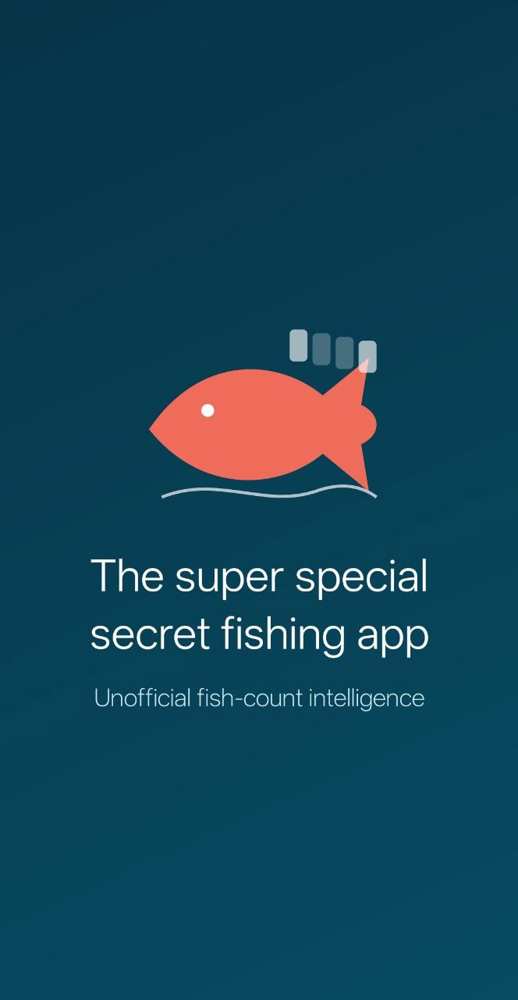
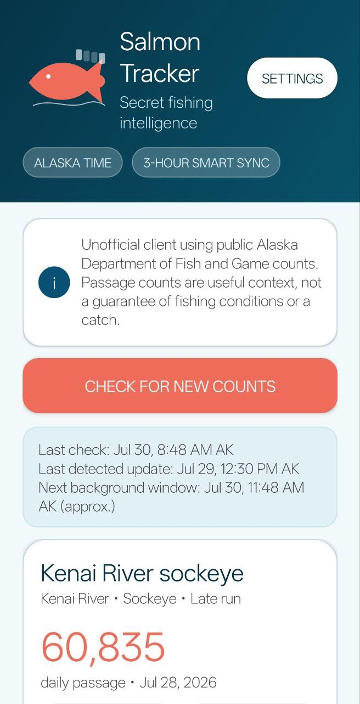

# Salmon Tracker

An independent Android app for following public Alaska salmon passage counts, comparing past runs, and receiving optional count-change alerts.

[Google Play](https://play.google.com/store/apps/details?id=com.tripperdee.salmontracker) · [Website](https://tripperdeelabs.com/salmon-tracker/) · [Privacy](https://tripperdeelabs.com/salmon-tracker/privacy/) · [Report an issue](https://github.com/jtripppiie/salmon-tracker/issues)

## What it does

- Follow selected Kenai, Kasilof and Russian River fish-count projects.
- View daily and cumulative counts, with seven-day, 14-day and season charts and comparison runs from the previous five years.
- Receive optional alerts for new or revised official counts; configure quiet hours, project muting and synchronization preferences.
- Read cached counts when offline. An internet connection is required to retrieve fresh reports.
- Keep preferences and cached data on the device, without an account, advertising or analytics SDK.

The recorded Google Play model is a **$0.99 USD one-time purchase**, with no subscriptions or in-app purchases. Store prices and availability can vary. Source code is available under [GPL-3.0-or-later](LICENSE); free software licensing is separate from the store's download price.

## Screenshots

 

These are the existing store assets; recapture and review them against the candidate before a new release.

## Build and test

The checked-in source identifies **1.0.3 (version code 6)**, package `com.tripperdee.salmontracker`. It requires Android 13+ (API 33), targets API 36, and builds with JDK 17 and Android SDK 36. This source version is not a claim about the latest live store release.

Use Android Studio or the included Gradle wrapper; no separate Gradle installation is needed. Configure your SDK through Android Studio, an ignored `local.properties`, or your environment.

```bash
./gradlew --no-daemon testDebugUnitTest lintDebug assembleDebug
```

Debug APK: `app/build/outputs/apk/debug/app-debug.apk`. GitHub Actions runs the unit tests and builds a debug APK using the same wrapper. Debug builds do not require the private release key.

For signed release builds, use the existing upload identity and follow the [release guide](docs/RELEASE_README.md). Never replace the signing key to work around a configuration problem.

## Repository guide

| Location | Purpose |
|---|---|
| `app/src/main/` | Android application code, manifest and UI resources |
| `app/src/test/` | Parser and fish-count logic tests |
| `app/schemas/` | Versioned Room database schemas; retain for migration work |
| `gradle/wrapper/`, `gradlew`, `gradlew.bat` | Reproducible Gradle entry points |
| `fastlane/metadata/android/en-US/` | Store copy, versioned changelogs and images |
| `docs/` | Build, release, submission and privacy documentation |
| `.github/workflows/` | Continuous integration |
| `.fdroid.yml` | F-Droid source-build metadata; separate from Google Play signing |

Build outputs, local SDK settings, signing files and private development notes are ignored. Do not commit chat transcripts, credentials, APKs, AABs or caches. Keep deliverables outside source control and preserve the source assets and license notices.

## Documentation

- [Build it yourself](docs/BUILD-IT-YOURSELF.md): beginner's walkthrough and code map.
- [Release guide](docs/RELEASE_README.md): signing, verification, internal testing and release checklist.
- [Google Play submission](docs/PLAY-SUBMISSION.md): listing draft and declarations to review.
- [F-Droid submission](docs/FDROID-SUBMISSION.md): source tags and separate distribution process.
- [Privacy policy source](docs/privacy-policy.html): app data and network behavior.

## Data source and limitations

Salmon Tracker is **not affiliated with or endorsed by the State of Alaska or the Alaska Department of Fish and Game**. It retrieves public reports from the [ADF&G Fish Counts service](https://www.adfg.alaska.gov/sf/FishCounts/).

Counts can be preliminary, revised or delayed. They do not guarantee fishing conditions or success; consult official regulations and emergency orders. The public export is not a documented application API, and upstream format changes may require an app update. The app uses a JSON export with an HTML-table fallback, caches data in Room, and retries transient network failures through WorkManager.

The first successful synchronization establishes a baseline without announcing historical records. Later changed records become eligible for alerts after storage; notification permission and user settings still apply.

## Support and license

For support, contact **feedback@tripperdeelabs.com** or open an issue with the app version, Android version, affected project and steps to reproduce. Remove personal information from screenshots and logs.

Copyright © 2026 Jeremey Tripp. Licensed under [GNU GPL version 3 or later](LICENSE).
